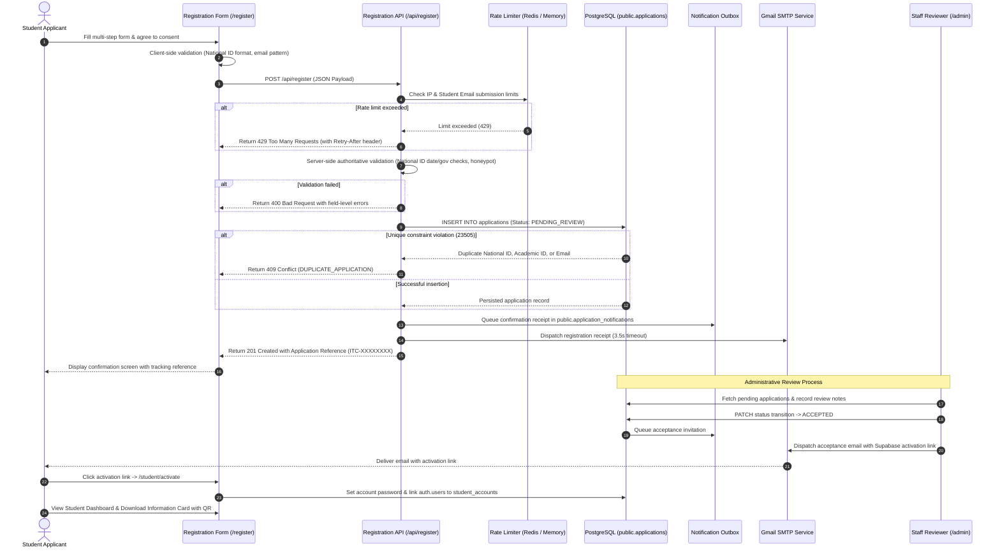

# IT Club Recruitment

> **A secure, high-throughput recruitment and interview management platform built for IT Club at Borg El Arab Technological University (BATU).**


---

## Arabic Summary | ملخص المشروع بالعربية

منصة **IT Club Recruitment** هي نظام متكامل لإدارة عمليات التوظيف والمقابلات الشخصية لنادي تكنولوجيا المعلومات بجامعة برج العرب التكنولوجية (**BATU**). توفر المنصة موقعاً تعريفياً وتفاعلياً للطلاب، واستمارة تسجيل متعددة المراحل تدعم التحقق الصارم من الرقم القومي والبريد الجامعي، ونظاماً متطوراً لمنع التكرار على مستوى قاعدة البيانات PostgreSQL. كما تشمل بوابة إدارية آمنة للجان لمراجعة الطلبات، ونظام إشعارات بريدية فورية عبر Gmail SMTP، وبوابة للطلاب المقبولين مع بطاقة تعريف رقمية ورمز QR مشفر لحضور المقابلات الشخصية، وسجل تدقيق غير قابل للتعديل خاص بإدارة المنصة.

---

## Table of Contents

- [Overview and Goals](#overview-and-goals)
- [Architecture Overview](#architecture-overview)
- [Features](#features)
- [Screenshots and Visual Documentation](#screenshots-and-visual-documentation)
- [Technology Stack](#technology-stack)
- [Application Routes](#application-routes)
- [Registration and Application Lifecycle](#registration-and-application-lifecycle)
- [Database Schema and Migrations](#database-schema-and-migrations)
- [Authentication, Authorization, and Roles](#authentication-authorization-and-roles)
- [Security and Privacy](#security-and-privacy)
- [Gmail SMTP Configuration](#gmail-smtp-configuration)
- [Environment Setup](#environment-setup)
- [Local Development and Database Commands](#local-development-and-database-commands)
- [Testing, Quality Assurance, and Build](#testing-quality-assurance-and-build)
- [Deployment](#deployment)
- [Scheduled Health Checks](#scheduled-health-checks)
- [Troubleshooting](#troubleshooting)
- [Project Structure](#project-structure)
- [Limitations and Roadmap](#limitations-and-roadmap)
- [Contribution and Maintenance](#contribution-and-maintenance)
- [License](#license)

---

## Overview and Goals

IT Club Recruitment is engineered to manage high-volume student recruitment drives without manual spreadsheets, duplicate submissions, or untracked candidate communications. Designed specifically for university technology clubs, the platform operates across four primary operational boundaries:

1. **Public Recruitment & Discovery**: A modern public portal introducing candidates to the club's technical committees, event archives, sponsorship network, and the recruitment process.
2. **Student Registration & Lifecycle Tracking**: A multi-step application wizard enforcing strict Egyptian academic and identity constraints, issuing tamper-proof application reference codes, and providing real-time submission tracking.
3. **Staff Evaluation & Decision Management**: A role-based administrative portal where committee heads and executive officers review submissions, record private evaluation notes, execute state-machine transitions, and inspect analytics charts.
4. **Candidate Credentialing & On-Site Attendance**: An authenticated portal for accepted candidates featuring an exportable Candidate Information Card and opaque QR check-in token, paired with an on-site camera scanner for instant interview verification.
5. **Operational Integrity & Telemetry**: Immutable audit logging restricted to project owners, distributed sliding-window rate limiting to absorb campus Wi-Fi traffic bursts, and transactional outbox email processing.

---

## Architecture Overview

The system uses Next.js App Router for server-rendered interfaces and API Route Handlers. Supabase provides managed PostgreSQL and authentication services. Server-side privilege separation guarantees that the public browser never receives elevated database privileges.

```mermaid
flowchart TD
    subgraph Client ["Client Layer (Browser)"]
        PublicUser["Public Applicant"]
        StudentUser["Accepted Student"]
        StaffUser["Staff Reviewer / Owner"]
    end

    subgraph NextServer ["Next.js Application Server (Node.js Runtime)"]
        Middleware["Session Middleware (/middleware.ts)"]
        PublicPages["Public Pages & Registration Flow"]
        StudentPortal["Student Dashboard (/student)"]
        AdminPortal["Admin Dashboard (/admin)"]
        
        subgraph RouteHandlers ["API Route Handlers"]
            RegisterAPI["POST /api/register"]
            ActivateAPI["POST /api/student/activate"]
            AdminAppAPI["PATCH /api/admin/applications/[id]"]
            CheckInAPI["POST /api/admin/interviews/check-in"]
            AuditAPI["GET /api/admin/audit-logs"]
            CronWorker["POST /api/admin/notifications/process"]
        end

        subgraph SecurityModules ["Security & Operations Core"]
            RateLimiter["Rate Limiter (Upstash Redis + Memory Fallback)"]
            Validator["Validation Engine (National ID & Email)"]
            AuthGuard["Server Auth & RBAC (roles.ts & server.ts)"]
            AuditService["Audit Logger (audit/service.ts)"]
            Mailer["Transactional Mailer (Gmail SMTP)"]
        end
    end

    subgraph ExternalServices ["Data & Infrastructure Services"]
        UpstashRedis[("Upstash Redis (Sliding Window Limits)")]
        GmailSMTP["Gmail SMTP Server (Nodemailer)"]
        
        subgraph SupabasePlatform ["Supabase Platform"]
            SupabaseAuth["Supabase Auth (Users & Sessions)"]
            PostgreSQL[("PostgreSQL Database (RLS Enforced)")]
            HealthPing["public.health_ping() (Zero-Storage RPC)"]
        end
    end

    subgraph Automation ["Automated Monitoring"]
        GHActions["GitHub Actions (supabase-activity-check.yml)"]
    end

    %% Client requests
    PublicUser --> PublicPages
    PublicUser --> RegisterAPI
    StudentUser --> StudentPortal
    StudentUser --> ActivateAPI
    StaffUser --> AdminPortal
    StaffUser --> AdminAppAPI
    StaffUser --> CheckInAPI

    %% Routing & Middleware
    Middleware --> AuthGuard
    RegisterAPI --> RateLimiter
    RegisterAPI --> Validator
    RegisterAPI --> AuditService
    RegisterAPI --> Mailer
    RegisterAPI --> PostgreSQL

    %% Rate limiting & caching
    RateLimiter -.-> UpstashRedis

    %% Email dispatch
    Mailer --> GmailSMTP
    CronWorker --> Mailer

    %% Internal Admin Actions
    AdminAppAPI --> AuthGuard
    AdminAppAPI --> PostgreSQL
    AdminAppAPI --> AuditService
    AdminAppAPI --> Mailer
    CheckInAPI --> PostgreSQL
    CheckInAPI --> AuditService
    AuditAPI --> PostgreSQL

    %% Database & Auth connections
    AuthGuard --> SupabaseAuth
    AuthGuard --> PostgreSQL
    GHActions -.->|Every 8 Hours (Anon Key)| HealthPing
```

### Key Architectural Boundaries

- **Browser vs. Server**: Browser bundles access Supabase solely via `NEXT_PUBLIC_SUPABASE_URL` and `NEXT_PUBLIC_SUPABASE_PUBLISHABLE_KEY` (or standard cookie-based user sessions). All administrative mutations, applicant reviews, and initial insertions execute on the server using `SUPABASE_SERVICE_ROLE_KEY`.
- **Privilege Lockdown**: Sensitive applicant records are protected by PostgreSQL Row-Level Security (RLS). The `public.applications` and `public.audit_events` tables reject direct client-side modifications.
- **Fail-Safe Email Dispatch**: If Gmail SMTP credentials are missing or the provider times out, database insertion succeeds, the application reference code is returned to the student, and the email notification is queued in `public.application_notifications` for retry.

---

## Features

### 1. Public Portal & Recruitment Brand
- **Interactive Landing Page (`/`)**: Hero section, club narrative, track overview, interview schedule, committee heads directory, and sponsor showcase.
- **Committee Tracks (`/tracks`)**: Comprehensive breakdown of the six operational and technical committees:
  - **IT** (*Information Technology* / تكنولوجيا المعلومات)
  - **R&D** (*Research & Development* / البحث والتطوير)
  - **OC** (*Organizing Committee* / اللجنة التنظيمية)
  - **SM** (*Social Media* / التواصل الاجتماعي)
  - **PR** (*Public Relations* / العلاقات العامة)
  - **HR** (*Human Resources* / الموارد البشرية)
- **Recruitment Process (`/process`)**: Editorial guide explaining screening, technical/exploratory challenges, personal interviews, and onboarding.
- **Community & Events (`/community`, `/events`)**: Student member directory and archive of workshops, hackathons, and innovation summits.
- **Partnerships & Transparency (`/sponsors`, `/terms`, `/privacy`)**: University partner ecosystem, recruitment Terms of Use, and data handling policies.

### 2. Multi-Step Registration & Validation
- **Interactive Multi-Step Form (`/register`)**: Six-step responsive wizard covering personal identity, academic records, experience level, track preferences, motivation essays, and accuracy consent.
- **Structural National ID Validation**: 14-digit Egyptian National ID parser verifying birth century, Gregorian birth date, leap-year alignment, valid governorate origin codes (01–35, 88), sequence number, and gender deduction.
- **University Email Lockdown**: Restricts university email input strictly to `<STUDENT_NUMBER>@batechu.com` (numeric student ID before the domain).
- **Secondary Track Preference Enforcement**: Ensures candidates selecting a second track choose a different committee than their primary choice.
- **Anti-Automation Bot Traps**: Honeypot inputs to silently reject automated scrapers and bots (`AUTOMATION_DETECTED`).

### 3. Identity, Duplicate Prevention & Tracking
- **Authoritative Database Constraints**: PostgreSQL unique indexes on `national_id`, `lower(trim(academic_id))`, and `lower(trim(university_email))` guarantee that no duplicate application can exist, regardless of concurrent submissions.
- **Server-Generated Reference Codes**: Generates unique, non-enumerable tracking references formatted as `ITC-XXXXXXXX`.
- **Transactional Outbox Notifications**: Queues registration receipts into `public.application_notifications` with an idempotency key (`reg_receipt_<application_id>`) to prevent duplicate email transmissions.

### 4. Staff Authentication & Role-Based Authorization
- **Staff Login (`/login`)**: Secure email/password login portal for authorized committee staff.
- **Database-Backed Roles**: Dedicated `public.staff_members` table assigning verified roles (`owner` or `admin`). Metadata supplied in client JWT claims is strictly ignored.
- **One-Time Owner Bootstrap**: CLI tool (`scripts/bootstrap-owner.ts`) to initialize the first system Owner. The script locks against subsequent promotion once an Owner exists.
- **Owner vs. Admin Capabilities**:
  - **Admin**: Review applications, save internal feedback, update candidate statuses, operate the interview QR scanner.
  - **Owner**: All Admin capabilities, plus access to the immutable audit log (`/admin/audit-logs`) and staff member roster inspection (`/admin/settings`).

### 5. Application Review & State Machine Management
- **Dashboard Telemetry (`/admin`)**: Summary metrics, 24-hour velocity counters, pipeline funnel charts, and track preference distributions.
- **Searchable Roster (`/admin/applications`)**: Server-paginated table supporting full-text search across applicant name, reference code, email, academic ID, and track filters.
- **Candidate Dossier (`/admin/applications/[id]`)**: Full submission review, National ID masking (`88******`), reviewer note autosave, and status transition selector.
- **State Machine Enforcement**: Transition validation prevents invalid lifecycle jumps (e.g., from `PENDING_REVIEW` straight to `INTERVIEWED` without review).
- **Automatic Acceptance Flow**: Transitioning a candidate to `ACCEPTED` dispatches an acceptance invitation email containing a secure Supabase Auth account activation link.

### 6. Student Portal & Candidate Information Card
- **Student Account Activation (`/student/activate`)**: Dedicated portal for accepted students arriving via email invitation links to set up a password linked to their reference code.
- **Student Dashboard (`/student`)**: Authenticated portal showing real-time application status, interview date/time/location details, and credential status.
- **Candidate Information Card**: Printable and downloadable credential card displaying student details, committee track badge, and dynamic interview QR code.

### 7. QR Issuance & On-Site Interview Check-In
- **Opaque Token Issuance**: Generates secure random tokens (`itc_qr_...`) stored as SHA-256 hashes (`token_hash`) in `public.interview_qr_tokens`. QR codes encode only the opaque token and protocol, preventing student PII leaks if photographed.
- **Camera Scanner (`/admin/interviews/scan`)**: Real-time camera scanner with automated error diagnostics (detecting denied permissions, insecure HTTP contexts, and missing hardware).
- **Manual Verification Fallback**: Allows staff to manually type in candidate tokens or reference codes if camera access is unavailable.
- **Instant Attendance Feedback**: Audio chimes, device vibration, and visual confirmation cards indicating attendance status (`CHECK_IN_SUCCESS` or `ALREADY_CHECKED_IN`). Automatically updates candidate status to `INTERVIEWED`.

### 8. Auditing, Security & Burst Hardening
- **Immutable Audit Trail (`/admin/audit-logs`)**: Append-only log recording user logins, status transitions, reviewer notes, check-ins, and notification attempts.
- **Sensitive Data Redaction**: Automatically sanitizes National IDs, passwords, session tokens, and raw QR strings before writing audit rows.
- **Distributed Rate Limiting**: Upstash Redis sliding-window limiter with configurable IP limits (supporting shared campus NAT gateways) and email rate limits. Gracefully falls back to local memory if Redis is unreachable.
- **Observability Logging**: Formatted structured JSON logs tracking request correlation IDs, latency percentiles, database execution times, and HTTP outcomes.

---

## Screenshots and Visual Documentation

> [!NOTE]
> **Documentation Checklist (UI Showcase Assets)**
> 
> Production UI screenshots are maintained in the documentation assets repository to avoid committing real candidate or reviewer test data to source control.
> 
> When capturing reference assets for presentations or handoff documentation, record clean mock states for:
> - [ ] **Public Landing Page** (`/`): Desktop & Mobile Hero with track navigation.
> - [ ] **Multi-Step Registration Wizard** (`/register`): Step 1 (Personal Info) and Step 4 (Track Selection).
> - [ ] **Admin Metrics Dashboard** (`/admin`): KPI cards and review pipeline distribution charts.
> - [ ] **Applications Review Table** (`/admin/applications`): Search and filter bar with masked National IDs.
> - [ ] **Candidate Dossier** (`/admin/applications/[id]`): Reviewer note drawer and state machine controls.
> - [ ] **Interview QR Scanner** (`/admin/interviews/scan`): Live camera viewfinder with successful check-in card.
> - [ ] **Student Dashboard & Card** (`/student`): Candidate Information Card with rendered QR code.
> - [ ] **Owner Audit Logs** (`/admin/audit-logs`): Filtered event table showing timestamped transitions.

---

## Technology Stack

| Technology | Verified Version | Role in IT Club Recruitment |
| :--- | :--- | :--- |
| **Next.js** | `16.3.8` | Core web framework, App Router, SSR middleware, and API Route Handlers. |
| **React** | `19.2.8` | UI component library with Concurrent Mode and React Server Components. |
| **TypeScript** | `^5.0.0` | Strict static typing across models, API contracts, and validation schemas. |
| **Tailwind CSS** | `^4.0.0` | Modern CSS engine powering responsive layouts, dark aesthetics, and animations. |
| **PostgreSQL** | *Supabase Managed* | Authoritative relational storage, unique constraints, and Row-Level Security. |
| **Supabase SSR** | `0.12.7` | Secure cookie-based session handling and authentication exchange. |
| **Supabase JS** | `2.117.3` | Database client for service-role administration and public RPC invocation. |
| **Nodemailer** | `10.1.0` | Direct Gmail SMTP transactional transport for receipts and acceptance invites. |
| **Upstash Redis** | `1.39.0` | Serverless REST-based Redis client powering distributed sliding-window rate limits. |
| **Upstash Ratelimit** | `2.2.0` | Algorithm implementation for sliding-window rate limiting. |
| **QRCode** | `1.5.4` | Server-side vector DataURL rendering for candidate QR credential cards. |
| **html5-qrcode** | `2.3.8` | Client-side camera-based QR code reader for on-site interview check-ins. |
| **Lucide React** | `1.52.0` | Consistent iconography across dashboards, indicators, and forms. |
| **GitHub Actions** | *v4 Workflow* | Automated external health check to prevent Supabase Free inactivity pausing. |

---

## Architecture and Security Boundaries

```
[ Browser / Public Client ]
           │
           │ (HTTPS, Anon Publishable Key / User Cookies)
           ▼
[ Next.js Edge Middleware ] ─── (Intercepts /admin, checks user session)
           │
           ▼
[ Next.js Server Components & Route Handlers ]
           │
           ├──► [ Upstash Redis ] (Sliding window check via REST)
           ├──► [ Validation Engine ] (Structural Egyptian National ID & Email check)
           ├──► [ Gmail SMTP ] (Direct TLS connection via Nodemailer)
           │
           │ (Server-Only SUPABASE_SERVICE_ROLE_KEY)
           ▼
[ Supabase PostgreSQL & Auth ]
           ├── applications (RLS write-only for anon, read for staff/self-student)
           ├── staff_members (RLS read-only for self, manage for service_role)
           ├── student_accounts (RLS read-only for self, manage for service_role)
           ├── interview_qr_tokens (RLS read for student/staff, manage for staff)
           ├── audit_events (RLS read-only for owner, append-only service_role)
           └── application_notifications (RLS read for staff, manage for service_role)
```

---

## Application Routes

### Public Pages
| Route Path | Access Level | Description |
| :--- | :--- | :--- |
| `/` | Public | Official landing page, about club, committees, interview information, and partners. |
| `/register` | Public | Multi-step candidate registration wizard with client and server validation. |
| `/tracks` | Public | In-depth breakdown of the six technical and operational committee tracks. |
| `/process` | Public | Step-by-step recruitment roadmap, timeline, and candidate guidelines. |
| `/events` | Public | Community archives, hackathons, and technical workshop gallery. |
| `/community` | Public | Student member directory and committee team rosters. |
| `/sponsors` | Public | Partnership tiers and university collaboration opportunities. |
| `/contact` | Public | Contact channels, physical campus location, and support email. |
| `/terms` | Public | Official recruitment participation and code-of-conduct terms. |
| `/privacy` | Public | Candidate data privacy, retention policies, and applicant protection terms. |

### Student Authentication & Dashboard
| Route Path | Access Level | Description |
| :--- | :--- | :--- |
| `/student/login` | Public / Student | Sign-in portal for registered students using university email and password. |
| `/student/activate` | Token Auth | Password setup page for candidates arriving from acceptance email links. |
| `/student` | Student | Personal candidate portal, status badge, interview details, and Information Card. |

### Staff Authentication & Administration
| Route Path | Access Level | Description |
| :--- | :--- | :--- |
| `/login` | Public / Staff | Secure staff authentication portal with redirect preservation (`?next=`). |
| `/admin` | Admin / Owner | Primary administration overview: recruitment metrics, funnel charts, velocity. |
| `/admin/applications` | Admin / Owner | Paginated candidate roster with full-text search, track filters, and quick actions. |
| `/admin/applications/[id]` | Admin / Owner | Detailed candidate dossier, response viewer, reviewer notes, and status transition. |
| `/admin/interviews/scan` | Admin / Owner | Real-time camera QR scanner with check-in feedback and manual fallback input. |
| `/admin/audit-logs` | **Owner Only** | Immutable system audit log with actor, action, date, and outcome filtering. |
| `/admin/settings` | Admin / Owner | Telemetry overview, SMTP status, rate limiter mode, and staff roster (Owner only). |

### API Endpoints
| Endpoint | Method | Access Level | Description |
| :--- | :--- | :--- | :--- |
| `/api/register` | `POST` | Public (Rate Limited) | Validates and persists new applications; dispatches confirmation receipt. |
| `/api/auth/verify-staff` | `POST` | Authenticated | Validates whether the active session has an assigned staff role. |
| `/app/auth/confirm` | `GET` | Public (Token/Code) | Handles Supabase Auth OTP verification and PKCE exchange; sets cookies. |
| `/app/auth/signout` | `POST`, `GET` | Authenticated | Terminates user session and redirects to `/login`. |
| `/api/student/activate` | `POST` | Authenticated Invite | Verifies reference code, sets account password, and links student account. |
| `/api/student/me` | `GET` | Student | Returns authenticated student profile and linked application record. |
| `/api/student/qr` | `GET` | Student | Generates or fetches active interview QR code for accepted candidates. |
| `/api/admin/me` | `GET` | Staff | Returns authenticated staff profile and assigned role (`owner` / `admin`). |
| `/api/admin/metrics` | `GET` | Staff | Returns live dashboard statistics, status counts, and track breakdowns. |
| `/api/admin/applications` | `GET` | Staff | Returns paginated applications matching search queries and track filters. |
| `/api/admin/applications/[id]` | `GET` | Staff | Fetches full candidate record including reviewer notes and submission data. |
| `/api/admin/applications/[id]` | `PATCH` | Staff | Updates application status or reviewer notes; dispatches acceptance email. |
| `/api/admin/interviews/check-in` | `POST` | Staff | Verifies QR token or manual code and marks candidate as interviewed. |
| `/api/admin/audit-logs` | `GET` | **Owner Only** | Returns paginated audit trail events matching filter criteria. |
| `/api/admin/notifications/process` | `POST` | `CRON_SECRET` / Staff | Background outbox worker to process queued email notifications. |

---

## Registration and Application Lifecycle

The registration lifecycle is designed for zero data loss during traffic spikes while preventing duplicate registrations.



### Application Status State Machine

The database and application layer enforce valid status transitions defined in `lib/admin/transitions.ts`:

```
               ┌────────────────────────────────────────────────────────┐
               │                                                        │
               ▼                                                        │
        [PENDING_REVIEW] ───► [UNDER_REVIEW] ───► [SHORTLISTED]         │
               │                      ▲                  │              │
               │                      │                  ▼              │
               ├──► [NEEDS_CORRECTION]┘         [INTERVIEW_SCHEDULED]   │
               │                                         │              │
               │                                         ▼              │
               │                                   [INTERVIEWED]        │
               │                                         │              │
               ▼                                         ▼              │
        [WAITLISTED] ◄────────────────────────────► [ACCEPTED]          │
               │                                         ▲              │
               ▼                                         │              │
          [REJECTED] ────────────────────────────────────┴──────────────┘
```

- **`PENDING_REVIEW`**: Initial status upon successful submission.
- **`UNDER_REVIEW`**: Assigned when a staff member begins assessing the application.
- **`NEEDS_CORRECTION`**: Candidate provided unclear or incomplete details; awaiting correction.
- **`SHORTLISTED`**: Candidate passed initial screening and qualifies for an interview.
- **`INTERVIEW_SCHEDULED`**: Candidate assigned an interview slot (enables QR token generation).
- **`INTERVIEWED`**: Candidate checked in via QR scanner or marked as interviewed.
- **`ACCEPTED`**: Candidate approved for membership (triggers activation email and QR issuance).
- **`WAITLISTED`**: Candidate meets criteria but is placed on the reserve roster.
- **`REJECTED`**: Application declined for the current recruitment round.

---

## Database Schema and Migrations

Database migrations reside in [`supabase/migrations/`](supabase/migrations/) and must be applied in sequential timestamp order.

### Summary of Database Migrations

| Migration File | Primary Responsibility |
| :--- | :--- |
| [`202610120001_create_applications.sql`](supabase/migrations/202610120001_create_applications.sql) | Creates `public.applications` table, core constraints, unique indexes, updated_at trigger, and initial RLS lockdown. |
| [`202610120002_security_hardening.sql`](supabase/migrations/202610120002_security_hardening.sql) | Adds `public.rate_limits` table, university email constraint (`^[0-9]+@batechu\.com$`), century/length checks on National ID (`^[23][0-9]{13}$`), and telephone format checks. |
| [`202610130001_staff_roles.sql`](supabase/migrations/202610130001_staff_roles.sql) | Creates `public.staff_members` table linked to `auth.users`, establishes RLS self-read policy, and grants staff select access on `public.applications`. |
| [`202610130002_application_notifications.sql`](supabase/migrations/202610130002_application_notifications.sql) | Creates `public.application_notifications` transactional outbox table with idempotency keys, delivery status, and retry counters. |
| [`202610130003_acceptance_activation.sql`](supabase/migrations/202610130003_acceptance_activation.sql) | Adds `user_id` and `activated_at` to `applications`, creates `public.student_accounts` mapping table, and grants accepted students self-read RLS access. |
| [`202610130004_student_dashboard_qr.sql`](supabase/migrations/202610130004_student_dashboard_qr.sql) | Adds interview schedule columns, creates `public.interview_qr_tokens` table, and grants students self-read access to their own QR token. |
| [`202610130005_audit_events.sql`](supabase/migrations/202610130005_audit_events.sql) | Creates `public.audit_events` table with immutable Owner-only RLS read policy, denying access to students and regular admins. |
| [`202610130006_activity_health_ping.sql`](supabase/migrations/202610130006_activity_health_ping.sql) | Creates pure read-only `public.health_ping()` SQL function returning `{"ok": true}` with zero storage, zero logging, and empty search path. |

### Core Tables

#### 1. `public.applications`
Stores candidate records submitted through `/register`.
- **Primary Key**: `id` (UUID, default `gen_random_uuid()`).
- **Unique Constraints**:
  - `application_reference`: String matching `^ITC-[A-Z0-9]{8}$`.
  - `national_id`: 14 digits, century 2 or 3 (`applications_national_id_unique`).
  - `academic_id`: Case-insensitive unique index (`applications_academic_id_unique`).
  - `university_email`: Case-insensitive unique index (`applications_university_email_unique`).
- **Check Constraints**:
  - `university_email`: Must match `^[0-9]+@batechu\.com$`.
  - `national_id`: Must match `^[23][0-9]{13}$`.
  - `phone`, `whatsapp`: Must match `^[+()0-9\s-]{8,30}$`.
  - `primary_track`, `secondary_track`: Must be in `('hr', 'pr', 'sm', 'oc', 'it', 'rnd')` and distinct.
  - `status`: Must be one of the 9 valid lifecycle states.
- **Row-Level Security**: Anon role is granted `INSERT` with check `(status = 'PENDING_REVIEW' AND consented_at IS NOT NULL)`. Authenticated staff members with role `owner` or `admin` are granted `SELECT`. Students are granted `SELECT` only on their own application when status is in `('ACCEPTED', 'INTERVIEW_SCHEDULED', 'INTERVIEWED')`.

#### 2. `public.staff_members`
Links Supabase Auth accounts to verified administrative privileges.
- **Primary Key**: `user_id` (UUID, references `auth.users(id)` ON DELETE CASCADE).
- **Columns**: `role` (`'owner'` or `'admin'`), `created_at`, `created_by`.
- **Row-Level Security**: Authenticated users may read only their own role row (`auth.uid() = user_id`). Full management is restricted to `service_role`.

#### 3. `public.student_accounts`
Maps authenticated Supabase student users to their accepted recruitment application.
- **Primary Key**: `id` (UUID).
- **Foreign Keys**: `user_id` (unique, references `auth.users(id)`), `application_id` (unique, references `public.applications(id)`).
- **Columns**: `university_email`, `activated_at`, `created_at`.
- **Row-Level Security**: Students can read only their own account record. Staff members can inspect student accounts.

#### 4. `public.interview_qr_tokens`
Stores tokens generated for candidate interview check-in.
- **Primary Key**: `id` (UUID).
- **Unique Columns**: `application_id` (one token per candidate), `token`, `token_hash` (SHA-256).
- **Columns**: `status` (`'ACTIVE'`, `'CHECKED_IN'`, `'REVOKED'`, `'EXPIRED'`), `checked_in_at`, `checked_in_by`, `expires_at`.
- **Row-Level Security**: Authenticated students can read only their own token. Staff members (`owner` or `admin`) can read and update tokens.

#### 5. `public.application_notifications`
Transactional outbox tracking email receipts and acceptance invitations.
- **Primary Key**: `id` (UUID).
- **Unique Columns**: `idempotency_key` (e.g. `reg_receipt_<app_id>`, `acceptance_invitation_<app_id>`).
- **Columns**: `application_id`, `notification_type`, `recipient_email`, `delivery_status` (`'PENDING'`, `'SENT'`, `'FAILED'`), `attempt_count`, `provider_message_id`, `safe_error_category`, `attempted_at`, `completed_at`.
- **Row-Level Security**: Service role has full management. Authenticated staff can view notification records.

#### 6. `public.audit_events`
Immutable audit log recording critical system actions.
- **Primary Key**: `id` (UUID).
- **Columns**: `created_at`, `actor_id`, `actor_email`, `actor_role`, `action`, `entity_type`, `entity_id`, `entity_reference`, `previous_status`, `new_status`, `metadata` (JSONB, sanitized), `request_id`, `outcome` (`'SUCCESS'`, `'FAILURE'`), `error_category`, `ip_address`.
- **Row-Level Security**: Only authenticated users with role `'owner'` in `public.staff_members` can execute `SELECT`. No `UPDATE` or `DELETE` policy exists for any role.

---

## Authentication, Authorization, and Roles

The application enforces a 4-tier authorization model:

```
[ Anonymous Visitor ]  ──► Public pages, /register (write-only via API)
[ Candidate / Student ] ──► /student/login, /student/activate, /student (Self-read only)
[ Staff Admin ]         ──► /admin, /admin/applications, /admin/interviews/scan
[ System Owner ]        ──► All Admin routes + /admin/audit-logs + Staff Roster Management
```

### Server-Side Session Verification
- `middleware.ts` guards all `/admin` routes. Unauthenticated requests are redirected to `/login?next=<path>`.
- Route Handlers (`verifyStaffApiRequest`) and Server Components (`requireStaffRole`) query `public.staff_members` using the privileged client to verify database roles. Client-supplied JWT claims or mutable metadata are strictly ignored.

### One-Time Owner Bootstrap Procedure
When setting up a fresh project, no Owner exists. Arbitrary elevation is blocked by database RLS. To initialize the first Owner:

1. Create a user account in Supabase Auth (via the Supabase Dashboard or an email invite).
2. Note the user's UUID or registered email.
3. Check the bootstrap status:
   ```powershell
   node --env-file=.env.local --experimental-strip-types scripts/bootstrap-owner.ts --status
   ```
4. Assign the Owner role:
   ```powershell
   node --env-file=.env.local --experimental-strip-types scripts/bootstrap-owner.ts your-email@domain.com
   ```
   *(Or pass the user UUID directly).*
5. The script checks `public.staff_members`. If no Owner exists, it assigns the role and creates an audit entry. Once established, subsequent bootstrap attempts are rejected (`ALREADY_INITIALIZED`).

---

## Security and Privacy

- **Server-Side Input Sanitization**: Form payloads are validated against strict schemas in `lib/validation/registration-schema.ts`. Unexpected or protected fields (e.g., `status`, `reviewer_notes`, `id`) are stripped before database insertion.
- **National ID Verification Boundary**: Structural checks verify length, century, Gregorian birth date, and registered governorate code. **Note**: This verifies structural validity under Egyptian Civil Registry specifications; official proof that the ID belongs to a living person requires governmental API access (قطاع مصلحة الأحوال المدنية), which is not accessible by public web applications.
- **National ID Masking**: Admin lists and student cards mask National IDs (e.g., displaying `2990101******`). Full National IDs are never returned to list endpoints.
- **SQL Injection Prevention**: All queries use parameterized Supabase PostgREST client methods. No raw SQL concatenation is performed in application routes.
- **Cross-Site Scripting (XSS) Defenses**: React automatically escapes rendered strings. HTML email templates pass user inputs through a strict `escapeHtml()` utility.
- **Strict Content Security Policy (CSP)**: `next.config.ts` enforces a strict CSP restricting `connect-src` to Supabase endpoints, `script-src` to self, and `frame-ancestors` to `'none'`.
- **Camera Permission Fallback**: The CSP sets `Permissions-Policy: camera=()`. On environments where this policy or browser permissions block camera access, `/admin/interviews/scan` seamlessly provides a manual token entry fallback verified by `camera-diagnostics.ts`.
- **Salted Hash Rate Limiting**: Client IP addresses and email keys are hashed using SHA-256 with a secret salt (`RATE_LIMIT_SALT`) before rate limit checking. Plain-text IPs are never stored in cache keys.
- **Payload Size Limits**: The registration API rejects non-JSON Content-Types with `415 Unsupported Media Type` and enforces a strict `64 KB` request body cap with `413 Payload Too Large`.

---

## Gmail SMTP Configuration

Transactional emails (registration receipts and acceptance invitations) are sent via **direct Gmail SMTP** using Nodemailer.

> [!IMPORTANT]
> **Google App Password Required**
> 
> You cannot use your personal Google account password. You must generate a dedicated 16-character **Google App Password**:
> 1. Open your Google Account -> **Security**.
> 2. Ensure **2-Step Verification** is turned ON.
> 3. Navigate to **App passwords** (search in Google settings).
> 4. Create a new password named `IT Club Recruitment`.
> 5. Copy the generated 16-character string into `GMAIL_APP_PASSWORD`.

### Environment Variables for Email

```env
# Gmail account address
GMAIL_USER=welcome@itclub.one

# 16-character Google App Password (spaces are automatically stripped)
GMAIL_APP_PASSWORD=abcdefghijklmnop

# Display sender header
EMAIL_FROM=IT Club Recruitment <welcome@itclub.one>

# Optional SMTP Host and Port (defaults to smtp.gmail.com:465 with SSL/TLS)
SMTP_HOST=smtp.gmail.com
SMTP_PORT=465

# Delivery Mode: 'sync' (dispatches during HTTP request) or 'outbox' (queued for worker)
EMAIL_DELIVERY_MODE=outbox

# Maximum milliseconds to wait for SMTP dispatch before backgrounding (default 3500ms)
EMAIL_DISPATCH_TIMEOUT_MS=3500
```

### Delivery Guarantees & Quotas
- **Bounded Dispatch Timeout**: When a candidate registers, SMTP dispatch is capped at 3.5 seconds. If Gmail SMTP takes longer or fails, the registration succeeds, the student receives their reference code, and the email is marked `PENDING` in `public.application_notifications`.
- **Honest status semantics**: `PENDING` means waiting for dispatch, `SENT` means Gmail SMTP accepted the message, and `FAILED` means the attempt failed. None of these states prove the recipient received or opened an email.
- **Gmail Quota Limitations**: Free Gmail accounts enforce a daily sending limit of 500 emails/day; Google Workspace accounts allow up to 2,000 emails/day. For high-volume burst recruitment, set `EMAIL_DELIVERY_MODE=outbox` and run the background processor via cron.
- **Outbox Processor**: `POST /api/admin/notifications/process` drains pending notifications in batches. Protect this endpoint in production using `Authorization: Bearer <CRON_SECRET>`.

### SMTP Self-Test

Run one server-only branded message to the configured `GMAIL_USER` mailbox; the recipient cannot be changed by the command:

```powershell
node --env-file=.env.local --experimental-strip-types scripts/email-self-test.ts
```

The output contains only authentication state, SMTP acceptance, sender, recipient, a safe error category, and a provider message ID. For the deployed environment, first authenticate the Vercel CLI, pull the Production variables into a temporary local env file, run the same command with that file, then remove the temporary file:

```powershell
vercel env pull .env.production.local --environment=production
node --env-file=.env.production.local --experimental-strip-types scripts/email-self-test.ts
```

---

## Environment Setup

### Prerequisites
- **Node.js**: `v20.x` or `v22.x` (LTS recommended).
- **npm**: `v10.x` or higher.
- **Supabase Account**: An active Supabase project with PostgreSQL and Auth enabled.
- **Upstash Redis Account** *(Optional but recommended)*: Free serverless Redis database for distributed rate limiting.
- **Gmail Account**: With 2-Step Verification and an App Password generated.

### Installation & Initialization

1. **Clone the repository**:
   ```bash
   git clone https://github.com/TheSeifDev/it-club.git
   cd it-club
   ```

2. **Install dependencies**:
   ```powershell
   npm install
   ```

3. **Configure Environment Variables**:
   Copy the example environment template:
   ```powershell
   Copy-Item .env.example .env.local
   ```
   Open `.env.local` and configure your credentials:

   ```env
   # ============================================================================
   # Supabase Credentials
   # ============================================================================
   NEXT_PUBLIC_SUPABASE_URL=https://your-project-id.supabase.co
   NEXT_PUBLIC_SUPABASE_PUBLISHABLE_KEY=your_anon_publishable_key
   SUPABASE_URL=https://your-project-id.supabase.co
   SUPABASE_PUBLISHABLE_KEY=your_anon_publishable_key
   SUPABASE_SERVICE_ROLE_KEY=your_secret_service_role_key

   # ============================================================================
   # Application URL
   # ============================================================================
   APP_BASE_URL=http://localhost:3000

   # ============================================================================
   # Gmail SMTP Configuration
   # ============================================================================
   GMAIL_USER=your-email@gmail.com
   GMAIL_APP_PASSWORD=your-16-char-app-password
   EMAIL_FROM=IT Club Recruitment <your-email@gmail.com>
   SMTP_HOST=smtp.gmail.com
   SMTP_PORT=465
   EMAIL_DELIVERY_MODE=sync

   # ============================================================================
   # Distributed Rate Limiting (Upstash Redis)
   # ============================================================================
   UPSTASH_REDIS_REST_URL=https://your-database.upstash.io
   UPSTASH_REDIS_REST_TOKEN=your_upstash_token
   RATE_LIMIT_FALLBACK_MODE=memory
   RATE_LIMIT_IP_MAX=60
   RATE_LIMIT_EMAIL_MAX=3

   # ============================================================================
   # Cron Worker Secret
   # ============================================================================
   CRON_SECRET=generate_a_random_32_char_hex_secret
   ```

4. **Start the local development server**:
   ```powershell
   npm run dev
   ```
   Open [http://localhost:3000](http://localhost:3000) in your browser.

---

## Local Development and Database Commands

### Supabase CLI Workflow

The project uses official Supabase migrations. To manage your database schema:

1. **Install and login to Supabase CLI**:
   ```powershell
   npx supabase login
   ```

2. **Link your remote Supabase project**:
   ```powershell
   npx supabase link --project-ref your-project-ref
   ```

3. **Inspect migration status**:
   ```powershell
   npx supabase migration list
   ```

4. **Preview pending migrations (Dry Run)**:
   ```powershell
   npx supabase db push --dry-run
   ```

5. **Apply pending migrations**:
   ```powershell
   npx supabase db push
   ```

> [!CAUTION]
> **Never run `supabase db reset` against a linked remote project!**
> 
> Running `db reset` wipes all tables, candidate records, and audit logs. Only apply incremental migrations using `supabase db push` after reviewing the SQL.

---

## Testing, Quality Assurance, and Build

The repository includes a comprehensive automated test suite utilizing Node.js's native test runner with TypeScript execution:

```powershell
npm test
```

### Verified Test Suite (182 Tests Across 15 Suites)

```
✔ tests/submission-pipeline.test.ts        (Payload validation, size caps, duplicate defense)
✔ tests/national-id.test.ts                (Century indicator, leap years, governorates, sequence)
✔ tests/university-email.test.ts           (Strict @batechu.com numeric student ID format)
✔ tests/registration-schema.test.ts        (Schema boundaries, track validation, honeypots)
✔ tests/security-controls.test.ts          (Hashed rate limiting, Upstash fallback, IP sanitize)
✔ tests/staff-auth.test.ts                 (RBAC roles, server session verification, Owner guard)
✔ tests/admin-dashboard.test.ts            (Metrics aggregation, filter queries, reviewer notes)
✔ tests/dashboard-interactions.test.ts     (Search, sorting, pagination, state transitions)
✔ tests/acceptance-invitation.test.ts      (Invitation link generation, idempotent delivery)
✔ tests/student-dashboard-qr.test.ts       (Activation flow, password requirements, QR tokens)
✔ tests/interview-scanner.test.ts          (QR check-in verification, duplicate scan rejection)
✔ tests/email-notifications.test.ts        (Outbox queueing, SMTP timeout handling, template XSS)
✔ tests/audit-logging.test.ts              (Immutable event records, metadata PII redaction)
✔ tests/capacity-hardening.test.ts         (Burst traffic concurrency, load resilience)
✔ tests/supabase-health-check.test.ts      (public.health_ping RPC guardrails, zero storage)
```

### Code Quality and Type Checking

- **TypeScript Compilation Check**:
  ```powershell
  npx tsc --noEmit
  ```
- **ESLint Code Quality Check**:
  ```powershell
  npm run lint
  ```
- **Production Build Validation**:
  ```powershell
  npm run build
  ```

---

## Deployment

IT Club Recruitment is optimized for deployment on Vercel, Node.js container environments, or standard cloud hosting platforms.

### Production Environment Checklist

1. **Environment Variables**: Configure all variables from `.env.example` in your hosting dashboard. Ensure `APP_BASE_URL` matches your custom production domain (e.g., `https://recruitment.itclub.one`).
2. **Supabase Auth Redirect URL**: Add `https://recruitment.itclub.one/auth/confirm` to the **Redirect URLs** allowlist in your Supabase Dashboard (**Authentication -> URL Configuration**).
3. **Database Migrations**: Apply all 8 SQL migrations using `npx supabase db push`.
4. **Owner Bootstrap**: Run the bootstrap CLI script once against your production Supabase database to assign your system Owner.
5. **Upstash Redis**: Connect a production Upstash Redis instance to provide globally distributed rate limiting across serverless regions.
6. **HTTPS Requirement**: Production hosting must use HTTPS. Both camera scanning and secure session cookies require a secure context.

---

## Scheduled Health Checks

Supabase Free Tier projects pause after 7 days of inactivity. To mitigate this risk without polluting application tables, a read-only health check runs via GitHub Actions.

- **Workflow File**: [`.github/workflows/supabase-activity-check.yml`](.github/workflows/supabase-activity-check.yml)
- **Schedule**: Every 8 hours (`17 0,8,16 * * *` UTC) and on manual `workflow_dispatch`.
- **Target**: Invokes the lightweight RPC function `public.health_ping()`.
- **Guardrails**:
  - Strictly read-only: performs 0 `INSERT`, 0 `UPDATE`, 0 `DELETE`, 0 `DDL` operations.
  - Creates 0 heartbeat tables and writes 0 log rows.
  - Reads 0 candidate, staff, or audit records.
  - Requires **only** the anonymous/publishable key. The script explicitly aborts if `SUPABASE_SERVICE_ROLE_KEY` is provided.
  - Enforces a 5,000ms timeout with credential redaction in GitHub Actions logs.

> [!NOTE]
> This external ping reduces the likelihood of inactivity pausing, but does not guarantee immunity from Supabase platform maintenance or organizational account limits.

---

## Troubleshooting

### 1. Database Connection or Permission Errors (`42501`)
- **Symptom**: `Registration database permission error` or `permission denied for table applications`.
- **Cause**: Server is missing `SUPABASE_SERVICE_ROLE_KEY`, or an operation was attempted using the anon client.
- **Fix**: Verify `SUPABASE_SERVICE_ROLE_KEY` is set in `.env.local`. Do not expose this key to browser variables.

### 2. Duplicate Application Registration (`409 Conflict`)
- **Symptom**: Candidate receives `An application has already been registered with these details`.
- **Cause**: The entered National ID, Academic ID, or University Email already exists in `public.applications`.
- **Fix**: Check `public.applications` in the Supabase Dashboard or have the student verify their reference code.

### 3. Gmail SMTP Authentication Failure (`EAUTH`)
- **Symptom**: `Invalid login: 535-5.7.8 Username and Password not accepted`.
- **Cause**: `GMAIL_APP_PASSWORD` is incorrect, contains typos, or was revoked in Google Account settings.
- **Fix**: Regenerate a 16-character Google App Password under **Security -> App Passwords**. Verify 2-Step Verification is active on the Google account.

### 4. Camera Viewfinder Unavailable During Interview Scanning
- **Symptom**: Camera displays `Camera access denied` or does not open on mobile.
- **Cause**: Insecure HTTP context (camera requires HTTPS or `localhost`), browser permission denied, or camera in use by another app.
- **Fix**: Access the dashboard over HTTPS. If the camera is unavailable, use the built-in **Manual Check-In** fallback input on the scanner page to enter candidate reference codes directly.

### 5. Staff Sign-in Redirect Loop (`/login`)
- **Symptom**: Staff logs in, but is immediately redirected back to `/login`.
- **Cause**: User exists in Supabase Auth but has no entry in `public.staff_members`.
- **Fix**: Run `node --env-file=.env.local --experimental-strip-types scripts/bootstrap-owner.ts <user_email>` to assign the Owner role, or insert an `admin` role row in `public.staff_members`.

---

## Project Structure

```
it-club/
├── .github/
│   └── workflows/
│       └── supabase-activity-check.yml   # Scheduled activity ping workflow
├── app/
│   ├── admin/                            # Staff management portal
│   │   ├── applications/                 # Review roster & candidate dossier ([id])
│   │   ├── audit-logs/                   # Owner-only audit event log
│   │   ├── interviews/scan/              # Camera QR scanner & manual check-in
│   │   ├── settings/                     # Operational telemetry & staff roster
│   │   ├── page.tsx                      # Dashboard KPIs & distribution charts
│   │   └── layout.tsx                    # Shared admin sidebar & authentication guard
│   ├── api/                              # Route Handlers (Node.js runtime)
│   │   ├── admin/                        # Applications, metrics, check-in, audit APIs
│   │   ├── auth/                         # Staff role verification API
│   │   ├── register/                     # Registration pipeline with validation & rate limits
│   │   └── student/                      # Activation, profile, and QR code APIs
│   ├── auth/                             # Auth callbacks (confirm OTP, signout)
│   ├── login/                            # Staff sign-in page
│   ├── register/                         # Multi-step public registration form
│   ├── student/                          # Student dashboard, login, and activation
│   ├── tracks/, process/, events/        # Public discovery and community pages
│   ├── community/, sponsors/, contact/   # Informational and partnership pages
│   ├── terms/, privacy/                  # Terms of Use and Privacy Policy
│   ├── globals.css                       # Design tokens, Tailwind CSS 4 directives
│   ├── layout.tsx                        # Root layout, Google Fonts (Alexandria, Montserrat)
│   └── page.tsx                          # Public landing page
├── lib/
│   ├── admin/                            # Query helpers, state machine transitions, types
│   ├── audit/                            # Immutable audit logger and PII sanitizer
│   ├── auth/                             # Server-side auth, bootstrap logic, role verification
│   ├── email/                            # Gmail SMTP transporter, outbox service, templates
│   ├── interviews/                       # QR token generator, camera diagnostics, check-in
│   ├── observability/                    # Structured diagnostic logger
│   ├── security/                         # Upstash Redis & in-memory sliding window rate limiter
│   └── validation/                       # Egyptian National ID, university email, form schema
├── scripts/
│   ├── bootstrap-owner.ts                # One-time CLI tool to bootstrap initial Owner
│   ├── load-test.ts                      # Synthetic load testing and burst readiness harness
│   └── supabase-health-check.ts          # Zero-storage public.health_ping() test script
├── src/
│   ├── components/                       # Reusable UI widgets and section components
│   └── data/                             # Community events and partnership data
├── supabase/
│   └── migrations/                       # 8 sequential SQL migrations (tables, RLS, functions)
├── tests/                                # 15 automated test suites (182 verified tests)
├── utils/
│   └── supabase/                         # Browser, Server, and Middleware Supabase clients
├── middleware.ts                         # Edge session verification middleware
├── next.config.ts                        # Security headers, CSP, and Next.js configuration
├── package.json                          # Dependencies and npm scripts
└── tsconfig.json                         # Strict TypeScript compiler configuration
```

---

## Limitations and Roadmap

### Verified as Implemented
- [x] Multi-step registration flow with client and server schema validation.
- [x] Strict Egyptian National ID structural validation (century, calendar date, leap year, governorates).
- [x] University email lockdown strictly enforcing `<STUDENT_NUMBER>@batechu.com`.
- [x] Database-level duplicate rejection via unique constraints in PostgreSQL.
- [x] Direct Gmail SMTP integration via Nodemailer with Google App Password support.
- [x] Transactional outbox notification pattern with idempotency keys.
- [x] Distributed Upstash Redis rate limiting with automatic in-memory fallback.
- [x] Role-Based Access Control (`owner` vs. `admin` vs. `student`).
- [x] One-time CLI bootstrap tool for the initial project Owner.
- [x] Application review dashboard with state machine transition enforcement.
- [x] Student account activation and password creation.
- [x] Student dashboard with downloadable Candidate Information Card.
- [x] Dynamic QR token generation and live camera scanner check-in with manual fallback.
- [x] Immutable Owner-only audit logging with PII redaction.
- [x] Read-only Supabase activity health check via GitHub Actions.

### Implemented but Requiring External Configuration
- [ ] **Real Email Dispatch**: Requires valid `GMAIL_USER` and `GMAIL_APP_PASSWORD` in `.env.local` or hosting secrets.
- [ ] **Distributed Multi-Region Rate Limiting**: Requires `UPSTASH_REDIS_REST_URL` and `UPSTASH_REDIS_REST_TOKEN`. (Falls back cleanly to local memory when unset).
- [ ] **Automated Outbox Worker**: Requires an external cron service (e.g. GitHub Actions or cron-job.org) invoking `POST /api/admin/notifications/process` with `CRON_SECRET`.

### Partially Implemented
- [ ] **Interview Scheduling Calendar**: Interview date, time, and location columns exist in `public.applications` and display on the Student Information Card; automated batch time-slot assignment UI for committee heads is planned for a future update.

### Planned Features (Not Yet Implemented)
- [ ] Automated WhatsApp notifications via WhatsApp Cloud API.
- [ ] Bulk CSV/Excel export of shortlisted candidates for committee heads.
- [ ] Interview scoring rubrics and multi-interviewer rating aggregation.

---

## Contribution and Maintenance

1. **Branching Strategy**: Create short-lived feature branches branched from `main`:
   ```bash
   git checkout -b feat/your-feature-name
   ```
2. **Code Standards**:
   - Run type checks and linters before committing:
     ```powershell
     npx tsc --noEmit
     npm run lint
     npm test
     ```
   - Never commit `.env`, `.env.local`, or any private credential to git.
   - Do not edit applied database migrations; create a new timestamped migration file in `supabase/migrations/` for schema changes.
3. **Security Invariants**:
   - Never expose `SUPABASE_SERVICE_ROLE_KEY` to client components or public environment variables.
   - Always sanitize and redact National IDs and sensitive fields in loggers and audit events.

---

## License

No license has been provided for this repository. All rights are reserved by the IT Club organization and the original authors. Unauthorized copying, modification, redistribution, or commercial use should not be assumed.
